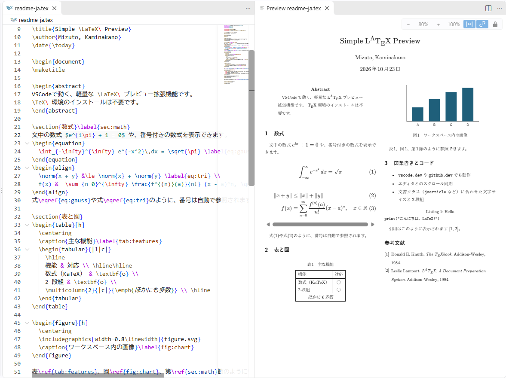

# Simple LaTeX Preview
English | [日本語](README.ja.md)

A lightweight LaTeX preview for VS Code. 
Unlike other LaTeX extensions, it also works in VS Code for the Web (vscode.dev / github.dev). No TeX installation is required.

- https://marketplace.visualstudio.com/items?itemName=kmmz1127.simple-latex-preview

## Usage
1. Open a `.tex` file
2. Click the preview icon at the top right of the editor, or run `LaTeX Preview: Open Preview to the Side` from the Command Palette
3. The preview updates as you type

Use the buttons at the top right of the preview to zoom out / in (`−` / `+`), show at actual size (`100%`), fit to the window (Fit), or turn scroll sync with the editor on / off (link icon).
Double-click on the preview to jump to that line in the editor.

The preview follows the active `.tex` editor. Click the lock icon to keep it on the current file; opening the preview again then creates a new preview, so you can view several files side by side.

## Supported syntax
- Math: `$...$` `\(...\)` `$$...$$` `\[...\]`, `equation` `align` `gather` `multline` (rendered with KaTeX)
- Headings: `\section` to `\subsubsection` (numbered), `\paragraph`
- `\title` `\author` `\date` `\maketitle`
- Text styles: `\textbf` `\textit` `\emph` `\texttt` `\underline`, etc.
- Lists: `itemize` `enumerate` `description`
- `figure` / `table` with `\caption`
- Images: `\includegraphics` shows PNG / JPEG / SVG / GIF / WebP from the workspace (`width` / `height` / `scale` / `angle`, `\graphicspath`). EPS / PDF are shown as a placeholder with the file name
- Tables: `tabular` `tabular*` `tabularx` (`l` `c` `r` `p{width}`, vertical rules `|`, `\hline`, `\cline`, `\multicolumn`, `\multirow`)
- Code: `verbatim` `Verbatim` `lstlisting` (with `caption` / `label`) `minted`, inline `\verb` / `\lstinline` (no syntax highlighting)
- Macros: `\newcommand` `\renewcommand` `\providecommand` `\def` (with arguments and default optional arguments; also usable inside math)
- Bibliography: `\bibliography` reads `.bib` files in the same folder as the `.tex` file; `\bibliographystyle` decides the order (citation order for `unsrt` / `junsrt`, by author otherwise; `alpha` labels). `thebibliography` / `\bibitem` and `\cite` / `\nocite` are also supported
- Equation numbering for `equation` / `align` / `gather` / `multline` (`\nonumber` / `\notag` / `\tag` supported)
- Cross references: `\label` with `\ref` / `\eqref` (sections, figures, tables and equations; forward references work)
- Font size, line spacing and indentation based on the document class (`jsarticle` / `article` families)
- Two-column layout with `twocolumn`, and page breaks based on `\textheight`
- `\setlength` in the preamble (`\textwidth` `\textheight` `\columnsep` `\parindent`)

Unsupported commands do not cause errors; they are shown as dimmed source text.

## Settings
| Setting | Default | Description |
| --- | --- | --- |
| `latexPreview.debounceMs` | `200` | Delay in milliseconds before the preview updates after an edit |
| `latexPreview.followActiveEditor` | `true` | The preview follows the active `.tex` editor. When `false`, each file gets its own preview |
| `latexPreview.showUnknownCommands` | `true` | Show unsupported commands as dimmed source text |

## Limitations
- Paragraphs are not split across pages
- `\input` / `\include` are not supported
- EPS / PDF images cannot be displayed
- `\def` with delimited parameters (e.g. `\def\foo#1.{...}`) is not supported
- Default dimensions are approximations of each document class
- Bibliography entries are formatted in a simplified `plain`-like style regardless of `\bibliographystyle`

## Bug reports and feature requests
- https://github.com/kmmz532/vscode-latex-preview/issues

For developers, see [docs/README.md](docs/README.md) (Japanese).

## License
- MIT
